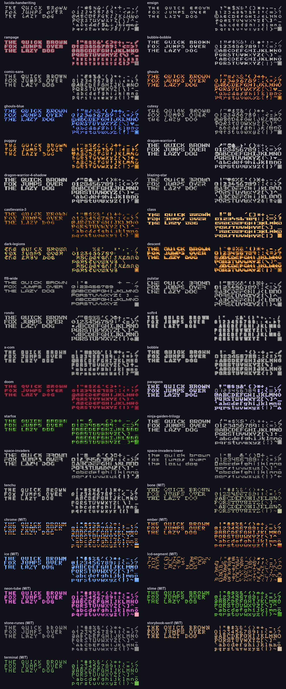
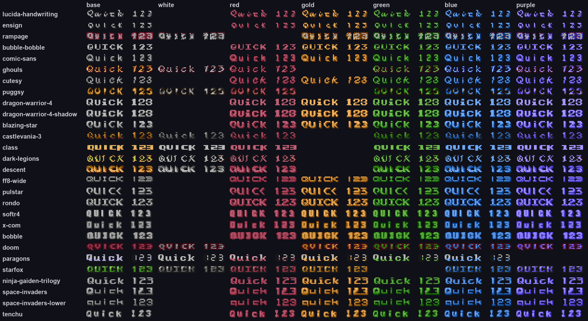
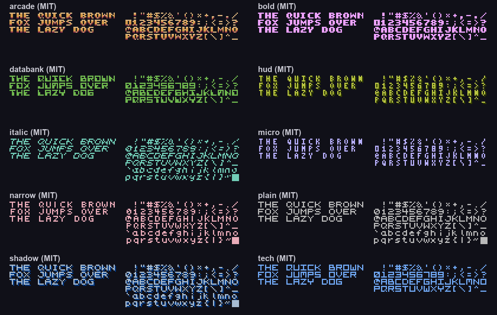
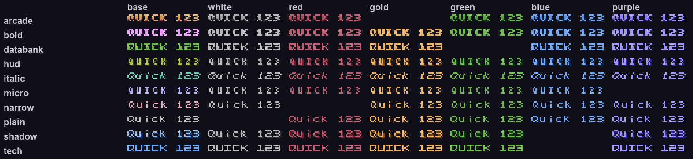

# 8bit-fonts

A collection of 8x8 and 6x6 8-bit fonts for the [GameTank](https://gametank.zone).

Each font has `upper-only/` and `numeric-only/` variants.
Each is packaged as GameTank .bin files and .bmp's for the gametank-sdk.

**Examples**
- **gametank-llvm-mos**: [example-llvm-mos.c](example-llvm-mos.c).
- **GameTank C SDK**: [example-cc65.c](example-cc65.c)
- **GameTank SDK Assembly**: [example-assembly-ca65.S](example-assembly-ca65.S)

**Libraries**
- **C**: [gametank-font.c](gametank-font.c), [gametank-font.h](gametank-font.h)
- **Assembly**: [gametank-font.s](gametank-font.s), [gametank-font.inc](gametank-font.inc)

Define `GT_NO_FONT8` or `GT_NO_FONT6` project-wide to exclude unneeded code if only a single size is being used (llvm-mos dead code prunes, cc65/ca65 do not).

🤖 This SDK was created inpart by AI.

## Fonts

8x8 ([gametank-fonts-6/](gametank-fonts/)):

6x6 ([gametank-fonts-6/](gametank-fonts-6/)):

